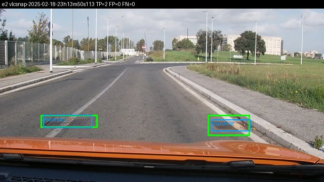
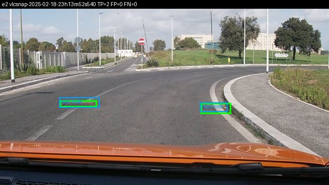
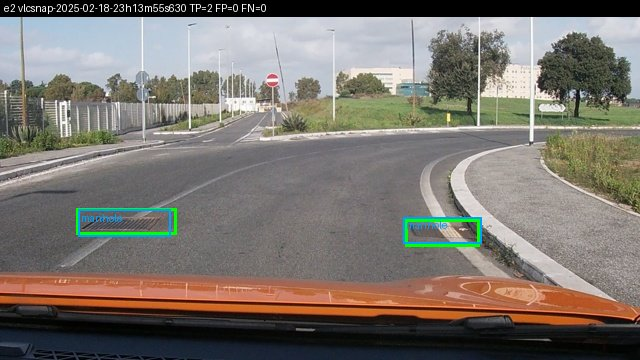
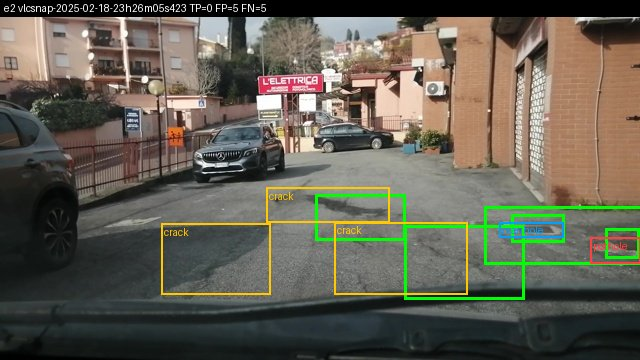
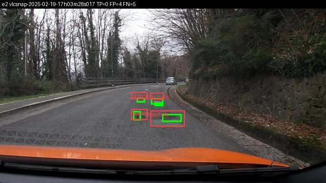
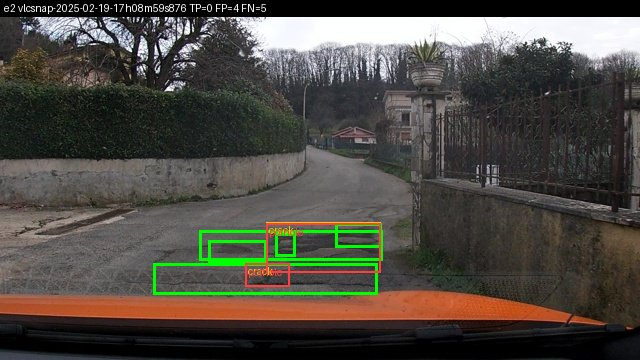

Họ tên: Nguyễn Văn Bảo
`dataset_version`: d10-21e4070301

## Bảng tổng hợp (số của bạn, lấy từ `report/evidence/*.json`)

Môi trường: Google Colab, Tesla T4 16 GB, QLoRA NF4 (ViT + projector + `lm_head` giữ fp16), 300 bước × batch 2 × tích luỹ 4, lr 2e-4, fp16 + GradScaler. Test: 311 ảnh, 583 box.

| Mã | Setup | Tham số huấn luyện | VRAM đỉnh (GB) | Phút | F1 | CI95 | FP/ảnh | F1 pothole | F1 crack | F1 manhole |
|---|---|---|---|---|---|---|---|---|---|---|
| E0 | zero-shot | 0 | – | – | 0.094 | 0.068–0.123 | 0.85 | 0.108 | 0.049 | 0.181 |
| E1 | LoRA LLM | 33,030,144 | 6.52 | 52.2 | 0.259 | 0.225–0.298 | 1.44 | 0.169 | 0.177 | 0.554 |
| E2 | + projector | 142,135,296 | 8.22 | 47.6 | 0.312 | 0.273–0.351 | 1.17 | 0.208 | 0.242 | 0.559 |
| E3 | + LoRA ViT | 148,426,752 | 8.39 | 51.9 | 0.405 | 0.362–0.446 | 1.11 | 0.305 | 0.311 | 0.685 |
| E4 | <điền: biến và giá trị> | | | | | | | | | |

`parse_valid_rate`: E0 0.968 · E1 0.990 · E2 0.997 · E3 1.000. Mean IoU của các cặp khớp: E0 0.606 · E1 0.670 · E2 0.666 · E3 0.691.

## 10 câu hỏi (trả lời bằng **số của bạn**, không chép lại tài liệu)

### Câu 1 — Kiến trúc: ViT, projector và LLM của Qwen3-VL-4B có bao nhiêu tham số mỗi khối, và E1/E2/E3 mỗi cái cập nhật khối nào?
Đếm bằng `python -m lab.inspect_model` (dựng model trên thiết bị meta từ config thật): tổng **4.438B**.
- **ViT: 415.3M**, trong đó 306.2M là patch embedding + 24 khối transformer, còn lại là projector.
- **Projector ≈ 109.1M** = `visual.merger` **27.3M** (gộp 2×2 patch rồi chiếu sang chiều của LLM) + `visual.deepstack_merger_list` **81.8M** (3 merger lấy đặc trưng ở các lớp ViT `[5, 11, 17]` và bơm vào các lớp đầu của LLM: DeepStack).
- **LLM (`language_model`, gồm embedding): 4.022B**. `lm_head` dùng chung trọng số với embedding (`tie_word_embeddings=True`) nên không thêm tham số.

Khối được cập nhật:
- **E1**: chỉ LoRA r=16 trên LLM, ở `q,k,v,o_proj` và `gate,up,down_proj` của 36 lớp = 252 module. Số tham số huấn luyện **33,030,144** khớp đúng công thức 36 × 16 × [(2560+4096)·2 + (2560+1024)·2 + (2560+9728)·3] = 36 × 917,504. Chỉ bằng 0.74% model; ViT và projector đóng băng.
- **E2**: E1 + mở toàn bộ projector, tổng **142,135,296**. Phần chênh so với E1 là 109,105,152, đúng bằng merger + deepstack merger.
- **E3**: E2 + LoRA trên 24 khối ViT (`attn.qkv`, `attn.proj`, `mlp.linear_fc1/2` = 96 module, tổng 348 module LoRA), tổng **148,426,752**. Phần chênh so với E2 là 6,291,456 = 24 × 16 × [(1024+3072) + (1024+1024) + (1024+4096)·2] = 24 × 262,144, khớp đúng LoRA trên ViT (hidden 1024, MLP 4096). Chỉ thêm 4.4% tham số so với E2, vì ViT nhỏ hơn LLM gần 10 lần.

### Câu 2 — E0: `parse_valid_rate` bằng bao nhiêu, và hai lỗi phổ biến nhất của model gốc là gì (kèm một ví dụ output thô)?
`parse_valid_rate` của E0 = **0.968** (10/311 output không parse được). Như vậy định dạng JSON không phải vấn đề chính; vấn đề chính là **nội dung box**:

1. **Bịa box / sai vị trí:** 264 FP so với 42 TP (precision 0.137). Lớp crack tệ nhất, precision chỉ 0.063 (179 FP / 12 TP): model gốc gọi "crack" cho nhiều vùng mà người gán nhãn không coi là vết nứt, hoặc vẽ box vết nứt với phạm vi khác hẳn nhãn.
2. **Bỏ sót:** recall 0.072, tức 541/583 box thật bị bỏ qua. Box ở đây rất nhỏ (trung vị ≈ 0,7% khung hình) và khái niệm "hư hại" của dataset hẹp hơn hiểu biết chung của model.

Model gốc đã dùng đúng thang 0–1000: các cặp khớp có mean IoU 0.606. Nếu model trả pixel thì gần như không có cặp nào đạt IoU ≥ 0.5.

Ví dụ output thô:
- Hỏng (ảnh `vlcsnap-2025-02-18-23h15m35s771`), bị cắt ở `max_new_tokens=384`:
  `[{"label": "crack", "bbox_2d": [557, 370, 600, 400]}, {"label": "crack", "bbox_2d": [557, 390, 600, 420]}, {"label": "crack", "bbox_2d": [557, 410, 600, 440]}, {"label": "crack", "bbox_2d": [557, 430, 600, 460]}, ... {"label": "crack", "bbox_2d": [557`
  Model rơi vào **vòng lặp suy biến**: sinh mãi một box crack cùng x, mỗi lần dịch y thêm 20, cho tới khi hết token nên JSON không đóng `]`. Ảnh `vlcsnap-2025-02-18-23h15m38s268` cũng y hệt (x 550–600, bước 40). Kiểu lỗi này vừa làm hỏng JSON vừa cho thấy xu hướng "bịa" hàng loạt box crack của model gốc.
- Hợp lệ: `vlcsnap-00200` → `[{"label": "crack", "bbox_2d": [750, 634, 850, 684]}]`, `vlcsnap-00201` → `[]`, `vlcsnap-00202` → `[{"label": "manhole", "bbox_2d": [307, 687, 399, 719]}]`. Định dạng đúng, đúng thang 0–1000; box có khớp nhãn hay không thì phải chấm IoU.

Sau finetune, model học được lúc nào phát `<|im_end|>` (loss được tính cả trên token này), nên `parse_valid_rate` tăng lên 0.990 (E1), 0.997 (E2) và 1.000 (E3).

### Câu 3 — Thang 0–1000: nếu chấm output theo pixel (hoặc ngược lại) thì F1 ra sao và vì sao? Bạn đã kiểm chứng điều này thế nào?
Qwen3-VL được huấn luyện grounding với toạ độ tương đối 0–1000, không phụ thuộc kích thước ảnh sau khi resize. Nếu đọc output 0–1000 như pixel của ảnh 640×360, `score.py --coord pixel` sẽ nhân x với 1000/640 = 1.56 và y với 1000/360 = 2.78. Box bị kéo giãn và dịch về phía dưới-phải, nên IoU với box thật gần như luôn < 0.5. Kết quả là F1 ≈ 0 dù JSON vẫn hợp lệ: đúng triệu chứng "F1 ≈ 0 mà JSON hợp lệ" trong GUIDE. Ngược lại, nếu train/prompt theo pixel mà chấm như 0–1000, box bị co lại về góc trên-trái và cũng hỏng.

Kiểm chứng:
1. Ở mục 2, đổi nhãn YOLO → 0–1000 rồi quy ngược về pixel; box trùng box gốc (sai số làm tròn ≤ 1 px).
2. E0 chấm theo `norm1000` có mean IoU 0.606 trên các cặp khớp, chứng tỏ model gốc đã nói "thang 0–1000".
3. Chấm lại **cùng file dự đoán của E2** với `--coord pixel` (coi output 0–1000 như pixel): F1 = **0.000**, P = R = 0, mean IoU = 0, so với **F1 0.312** khi chấm đúng `norm1000`. `parse_valid_rate` vẫn là 0.997, vì JSON không đổi, chỉ cách hiểu toạ độ đổi. FP/ảnh tăng từ 1.17 lên **1.73**: cả 175 TP trước đó đều biến thành FP, (364 + 175) / 311 = 1.73. Như vậy chỉ một sai lệch quy ước thang toạ độ cũng đủ biến model tốt nhất thành vô dụng, trong khi mọi chỉ số định dạng vẫn trông bình thường.

### Câu 4 — Mask loss: vì sao chỉ tính loss trên phần trả lời? Điều gì xảy ra nếu tính trên cả prompt và token ảnh?
Với ảnh 640×360, một chuỗi huấn luyện gồm **220 token ảnh** + **127 token prompt** + vài token của chat template ≈ 360 token đầu vào. Câu trả lời trung bình chỉ khoảng 70 token (≈ 29 token mỗi box × 2,4 box/ảnh, cộng `<|im_end|>`). Như vậy phần trả lời chỉ chiếm khoảng 16% chuỗi. `encode_example` đặt `labels = -100` cho toàn bộ tiền tố prompt (đã kiểm tra prompt đúng là tiền tố của chuỗi đầy đủ), nên loss chỉ tính trên JSON và `<|im_end|>`.

Nếu tính loss cả trên prompt và token ảnh:
- **Lãng phí gradient:** khoảng 84% token là thứ model không bao giờ phải sinh ra. Prompt giống hệt nhau ở mọi mẫu nên loss của nó nhanh chóng ≈ 0. Các token `<|image_pad|>` là placeholder, việc "dự đoán" chúng là vô nghĩa. Loss trung bình trông giảm đẹp nhưng tín hiệu học toạ độ bị pha loãng.
- **Học sai hành vi:** model có thể học lặp lại prompt, gây hại cho định dạng output.

Tính loss trên `<|im_end|>` giúp model học **dừng đúng lúc**. `parse_valid_rate` tăng từ 0.968 (E0) lên 0.990 (E1), 0.997 (E2) và 1.000 (E3).

### Câu 5 — Vì sao không thể huấn luyện đầy đủ projector nếu ViT bị lượng tử hoá 4-bit, và bạn đã xử lý thế nào? Vì sao projector phải ở float32?
Lớp NF4 của bitsandbytes lưu trọng số ở dạng nén 4-bit (tensor `uint8` + hằng số lượng tử). Đó không phải tham số thực nên không có gradient và không cập nhật trực tiếp được; với lớp 4-bit chỉ gắn được LoRA. Projector nằm trong `visual`. Nếu `visual` bị lượng tử thì `merger.linear_fc1/2` thành `uint8`, và E2 không thể "mở đầy đủ" projector.

Tôi gặp đúng lỗi này. Theo GUIDE, tôi đặt `llm_int8_skip_modules=["visual","lm_head"]`, nhưng transformers 5.19 so khớp bằng `re.match` (neo ở **đầu** tên module), nên `"visual"` không khớp `model.visual.merger...`. Assert kiểm tra dtype trong `load_model` báo: `visual.merger bị lượng tử hoá (torch.uint8)`. Tôi sửa bằng cách thêm tiền tố đầy đủ `"model.visual"`, và assert thêm `visual.blocks.0.attn.qkv` ở fp16 (cần cho LoRA ViT ở E3).

Projector phải ở fp32 vì:
1. **Bước cập nhật bị nuốt mất ở fp16:** lr 2e-4 cho bước cập nhật rất nhỏ so với trọng số. fp16 chỉ có khoảng 3 chữ số thập phân, nên nhiều bước cập nhật bị làm tròn về 0.
2. **GradScaler không unscale được gradient fp16.** Trạng thái Adam cũng cần độ chính xác cao.

Chi phí đo được: VRAM đỉnh tăng từ **6.52 GB (E1) lên 8.22 GB (E2)**, tức +1.70 GB. Con số này khớp ước tính 109M tham số × 16 byte (trọng số fp32 4 + gradient 4 + hai moment Adam 8) ≈ 1.75 GB.

### Câu 6 — Split theo phiên quay: vì sao chia ngẫu nhiên sẽ cho F1 cao giả? Số ảnh và số box từng lớp ở mỗi split là bao nhiêu?
Ảnh là các frame cắt từ video dashcam, nên hai frame liền kề gần như trùng nhau (cùng ổ gà, cùng vết nứt, chỉ lệch vài pixel). Nếu chia ngẫu nhiên, gần như mọi ảnh test đều có "anh em sinh đôi" trong train. Khi đó model chỉ cần **nhớ** vị trí box của frame bên cạnh là đạt F1 cao, nhưng con số đó không phản ánh khả năng tổng quát hoá sang đoạn đường mới. `prepare_data.py` gom ảnh theo phiên quay (ngày + giờ trong tên file) và gán **cả phiên** vào một split, nên không phiên nào xuất hiện ở hai split (kiểm tra ở mục 1).

| Split | Ảnh | pothole | crack | manhole |
|---|---|---|---|---|
| train | 1,422 | 1,074 | 1,750 | 691 |
| val | 276 | 66 | 470 | 103 |
| test | 311 | 121 | 299 | 163 |

Số box test khớp `tp + fn` trong `e0.json`: pothole 9+112 = 121, crack 12+287 = 299, manhole 21+142 = 163. Cái giá của việc chia theo phiên là phân bố lớp lệch: val chỉ có 66 pothole, test có tỉ lệ manhole cao hơn train. Vì vậy phải đọc F1 từng lớp và CI95.

### Câu 7 — So sánh E1/E2/E3: mở projector và LoRA trên ViT có đáng không (F1, CI95, VRAM, thời gian)?
**E1 → E2 (mở projector):**
- F1 tăng từ **0.259 lên 0.312** (+0.053).
- FP/ảnh giảm từ 1.44 xuống 1.17.
- Lớp crack hưởng lợi nhiều nhất: F1 0.177 → 0.242, FP 359 → 245. Pothole 0.169 → 0.208. Manhole gần như không đổi (0.554 → 0.559).

Cái giá: tham số huấn luyện gấp 4.3 lần (33.0M → 142.1M), VRAM đỉnh +1.70 GB (6.52 → 8.22 GB). Thời gian không tăng (52.2 và 47.6 phút); chênh lệch này chủ yếu do biến động giữa các phiên Colab, vì phần tốn thời gian vẫn là forward/backward qua LLM 4-bit.

Tuy vậy, CI95 của E1 [0.225, 0.298] và của E2 [0.273, 0.351] **chồng nhau** trên đoạn 0.273–0.298. Vì vậy chưa thể khẳng định chắc chắn E2 tốt hơn E1 trên tập test 311 ảnh. Xu hướng thì nhất quán: precision, recall và F1 của cả pothole lẫn crack đều tăng. Với T4 còn dư VRAM, mở projector là lựa chọn rẻ và đáng thử.

**E2 → E3 (LoRA ViT):**
- F1 tăng từ **0.312 lên 0.405** (+0.093), lớn nhất trong các bước E1 → E2 → E3.
- Cải thiện chủ yếu ở **recall**: 0.300 → 0.405 (TP 175 → 236), trong khi FP gần như giữ nguyên (364 → 346, FP/ảnh 1.17 → 1.11). Mean IoU của các cặp khớp cũng tăng (0.666 → 0.691), tức box chính xác hơn.
- Tăng ở cả ba lớp: pothole 0.208 → **0.305** (recall 0.198 → 0.322), crack 0.242 → 0.311, manhole 0.559 → 0.685 (recall 0.466 → 0.626).

Cái giá rất nhỏ: chỉ thêm 6.3M tham số (+4.4%), VRAM đỉnh +0.17 GB (8.22 → 8.39 GB), thời gian +4.3 phút (47.6 → 51.9 phút, cùng mức biến động giữa các phiên Colab).

Lần này CI95 của E2 [0.273, 0.351] và E3 [0.362, 0.446] **không chồng nhau** (cận trên E2 thấp hơn cận dưới E3). Đây là cải thiện có thể khẳng định trên tập test 311 ảnh.

Giải thích: ViT gốc được tiền huấn luyện trên ảnh tổng quát, không phải để phân biệt ổ gà nhỏ, vết nứt mảnh với vá đường, bóng râm. Projector (E2) chỉ có thể sắp xếp lại đặc trưng mà ViT đã trích; LoRA trên ViT (E3) cho phép **đổi chính đặc trưng thị giác**. Recall pothole tăng mạnh nhất, khớp với nhận định ở câu 9 rằng lỗi của pothole nằm ở chỗ box quá nhỏ để đặc trưng gốc "thấy". **Kết luận: LoRA trên ViT rất đáng**, với chi phí gần như không đáng kể trên T4.

### Câu 8 — Tập test có 311 ảnh: khoảng tin cậy rộng thế nào, và điều đó giới hạn kết luận so sánh các setup ra sao?
CI95 bootstrap theo ảnh (1000 lần) có độ rộng: E0 0.055 (0.068–0.123), E1 0.072 (0.225–0.298), E2 0.078 (0.273–0.351), E3 0.084 (0.362–0.446). Tức là khoảng ±0.035–0.04 quanh F1.

Hệ quả:
- **E1 so với E0:** chênh +0.164, CI hoàn toàn tách rời (cận trên E0 là 0.123, cận dưới E1 là 0.225). Kết luận "finetune giúp rất nhiều" là chắc chắn.
- **E2 so với E1:** chênh +0.053, nhỏ hơn độ rộng một CI, và hai CI chồng nhau. Chỉ nói được "E2 có xu hướng tốt hơn", không khẳng định được. Muốn chắc hơn cần bootstrap **ghép cặp** (cùng mẫu ảnh cho cả hai model), nhiều seed, hoặc test lớn hơn.
- **E3 so với E2:** chênh +0.093, lớn hơn độ rộng một CI, và hai CI tách rời (0.351 < 0.362). Kết luận "LoRA ViT giúp" là đáng tin.
- **Theo từng lớp còn kém tin cậy hơn:** test chỉ có 121 pothole, nên ±1–2 TP đã làm F1 pothole dao động vài điểm.

Mọi chênh lệch dưới khoảng 0.05 F1 giữa các setup (bao gồm E3 và E4) nên coi là chưa phân biệt được.

### Câu 9 — Phân tích lỗi theo lớp: lớp nào kém nhất và vì sao (kích thước box, số mẫu, ngữ nghĩa)? Kèm ảnh minh hoạ.
Ở E2, **pothole (0.208)** và **crack (0.242)** kém xa **manhole (0.559)**, dù manhole có ít box train nhất (691, so với 1,074 pothole và 1,750 crack). Vậy số mẫu không phải nguyên nhân chính.

- **Manhole:** hình tròn/vuông, viền kim loại rõ, kích thước ổn định, ngữ nghĩa không mơ hồ. Precision cao (0.70); lỗi chủ yếu là sót (recall 0.47).
- **Crack:** kém về **precision** (E1: 359/447 FP là crack). Vết nứt mảnh, dài, ranh giới mơ hồ. Một vết nứt dài có thể được gán nhãn là 1 box hoặc nhiều box nhỏ, nên dù model "thấy" đúng vết nứt, IoU ≥ 0.5 rất khó đạt. Vạch sơn, khe nối mặt đường và bóng cũng trông giống vết nứt.
- **Pothole:** kém về **recall** (0.198 ở E2). Box rất nhỏ: diện tích trung vị ≈ 0,7% khung hình ≈ 40×40 px trên ảnh 640×360. Mỗi token ảnh ứng với một ô 32×32 px, nên một ổ gà nhỏ chỉ chiếm 1–2 token. Ổ gà còn dễ lẫn với vá đường, vũng nước, bóng râm.

Ảnh minh hoạ (E2 trên test; **xanh lá = nhãn đúng**, đỏ = pothole, vàng = crack, xanh dương = manhole dự đoán; tiêu đề ghi TP/FP/FN của ảnh):

*Đúng (TP=2): hai nắp cống/song chắn rác hình chữ nhật, box dự đoán gần như trùng nhãn.*

*Đúng (TP=2): cùng hai nắp cống, frame cách ảnh trên khoảng 2 giây.*

*Đúng (TP=2): vẫn cảnh đó thêm 3 giây sau. Cả 3 ảnh "đúng" đều thuộc cùng phiên `23h13m` và gần như trùng nhau. Đây chính là lý do phải chia split theo phiên (câu 6): nếu chia ngẫu nhiên, các frame anh em này sẽ nằm ở cả train lẫn test.*

*Sai (TP=0, FP=5, FN=5): model dự đoán đúng **vùng** hư hại (3 crack, 1 manhole, 1 pothole nằm chồng lên các box nhãn) nhưng phạm vi box lệch: chỗ thì to hơn, chỗ thì dịch sang bên. Không cặp nào đạt IoU ≥ 0.5, nên một ảnh "gần đúng" bị tính 5 FP + 5 FN.*

*Sai (TP=0, FP=4, FN=5): các ổ gà rất nhỏ ở xa. Model tìm đúng 4 vị trí nhưng box dự đoán lớn gấp 2–3 lần box nhãn, nên IoU < 0.5. Ổ gà thứ 5 bị sót. Minh hoạ lý do recall pothole thấp: box chỉ vài chục pixel, tương đương 1–2 token ảnh.*

*Sai (TP=0, FP=4, FN=5): một mảng mặt đường vỡ lớn. Nhãn gốc chia thành 5 box (một box rộng phía dưới và nhiều box con), còn model chia thành 4 box theo cách khác. Ranh giới "một hư hại" là mơ hồ, nên IoU không đạt dù model nhìn đúng chỗ.*

Nhận xét chung: ở cả 3 ảnh sai, model **không nhìn nhầm chỗ** mà sai ở **độ chính xác của box** (to/nhỏ, gộp/tách) so với ngưỡng IoU 0.5. Vì vậy F1@0.5 đánh giá thấp model với các lớp có ranh giới mơ hồ (crack, mảng vỡ) hoặc box rất nhỏ (pothole).

### Câu 10 — E4: bạn đổi biến nào, kết quả thế nào, và kết luận có đáng tin không?
<điền sau khi chạy E4>

## Nhìn lại

- **Môi trường ngốn nhiều thời gian hơn mô hình:**
  - `llm_int8_skip_modules=["visual"]` âm thầm không có tác dụng với transformers 5.19 (so khớp neo ở đầu tên). Không có assert kiểm tra dtype thì E2 sẽ không mở được projector mà công cụ chấm không phát hiện.
  - `torchao 0.10` cài sẵn trên Colab làm `peft 0.21.2` báo lỗi khi gắn LoRA; phải gỡ torchao.
- **Thời gian thật gấp khoảng 2 lần ước lượng:** một lần huấn luyện 300 bước mất khoảng 48–52 phút trên T4 (GUIDE ước 20–30 phút), chưa kể suy luận test và tải model 8.9 GB mỗi phiên. Quota GPU miễn phí trở thành nút thắt chính.
- **Điều công cụ chấm chưa bắt được:** F1@IoU0.5 phạt rất nặng lớp crack vì cách gán nhãn vết nứt dài không nhất quán. Một dự đoán đúng vết nứt nhưng gộp/tách box khác người gán nhãn vẫn bị tính cả FP lẫn FN.
- <điền: điều bạn còn chưa hiểu / muốn thử thêm>
